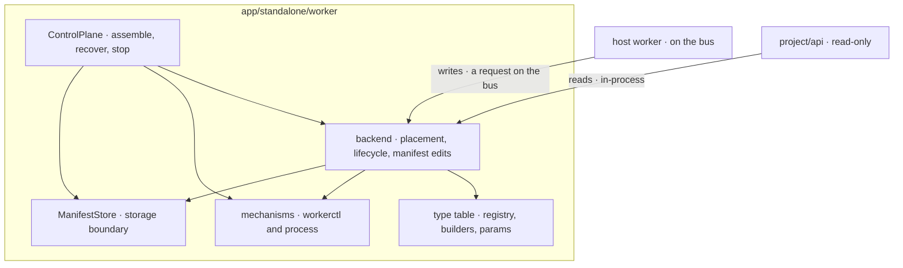

# worker — the standalone worker control plane

This package is the **complete worker control plane** for the standalone
deployment form. It owns every worker's manifest and lifecycle, assembles the
two lifecycle mechanisms it needs (`workerctl`, `process`), and exposes stable
exits for the host worker and the WebUI. The assembly injects storage providers
once; from then on the control plane recovers, runs and stops on its own.



The picture is about doors, not inventory: the WebUI has only one. It reads the
roster in-process through the injected `Manifest`, and every write it makes is a
bus request to the `host` worker — the path an agent's tool call takes.
`ControlPlane` assembles the backend and the two mechanisms and reads the
manifest set at recovery; the backend routes each placement to a mechanism, owns
the manifest edits, and persists through the injected `ManifestStore`.

The package's other inputs — the worker types it builds, `provider`, the
eventbus, the bus control plane — are inventory rather than shape; they are
listed in [Plane composition](#plane-composition) and [Files](#files).

## Plane composition

| piece | responsibility | where |
|---|---|---|
| `workerctl.Manager` | live instance lifecycle: build, spawn, suspend (snapshot), resume, restart, destroy, checkpoint | `core/impl/workerctl` |
| `process.Supervisor` | OS child lifecycle: launch, crash restart with backoff, stop, shutdown kill-tree | `process/` |
| identity provisioning | mint credentials, register identities with the bus control plane | `process/provision.go` |
| `typeRegistry` | which types exist, how each is built, which params each reads | `registry.go` |
| `ControlPlane` | owns the above, recovers the manifest set, exposes the exits | `controlplane.go` |

Neither library knows about placements. The control plane is what maps a
placement to mechanisms: `in-process` uses the manager, `managed-process` uses
the supervisor plus provisioning, `unmanaged-process` uses provisioning only.

## Manifest model

A manifest is one worker's persisted definition (`workers.json` /
`workers.archived.json`):

```go
type Definition struct {
    ID     string
    Type   string
    Params map[string]any   // the ONLY construction input
}

type Manifest struct {
    Definition
    Placement Placement       // in-process / managed-process / unmanaged-process

    Label       string
    Tags        []string
    Description string

    Command []string          // managed-process
    Cwd     string            // managed-process
}
```

Bus identity — publish/subscribe grants and credentials — is **not** here. The
bus control plane (`core/itfs/bus.Control`, implemented by
`core/impl/busctl`) is its single owner. `params` remains the single
construction bag:

| placement | params | validation |
|---|---|---|
| `in-process` | builder construction params | `SpawnParamsByType` |
| `managed-process` | the child's **environment** | flat string map, valid env keys, no `NIQ_*` |
| `unmanaged-process` | not passed | must be empty |

## Files

| File | Responsibility |
|---|---|
| `controlplane.go` | `Config` / `ControlPlane`: `New`, `Recover`, `Stop`, `HostBackend`, `Manifest`, the type table (`RegisterBuilders`, `RegisterBuilder`, `Types`), `Manager`, app-hosted state helpers. |
| `declaration.go` | The model, no IO: `Definition` / `Manifest`, `Placement` / `PlacementOf`, display metadata validation, `SanitizeID`, `Instantiate` / `InstantiateForm`. |
| `params.go` | `SpawnConfig` / `Spec` / `ManifestFromSpec`, the per-type spawn contract, `ValidateProcessParams`, and param readers. |
| `registry.go` | `typeRegistry`: type label → builder + spawn-parameter check. |
| `builders.go` | `BuildContext`, the type-label constants (`TypeInterface`, `DefaultWebUIID`, `DefaultHostWorkerID`), and one constructor per built-in type; `specConnect` ensures the worker's durable identity. |
| `identity.go` | `ensureIdentity`: register on first connect, keep an edited grant, seed the type default only once. |
| `backend.go` | `worker.Backend`: placement routing, lifecycle verbs, manifest edits, archive, protected ids, per-id serialization. |
| `store.go` | `ManifestStore`: the storage boundary `app/standalone/store` implements. |
| `process/` | Third-party process runtime: its own input contract (`spec.go`), provisioning (`provision.go`), supervision (`supervisor.go`), log/state dir naming (`ids.go`), platform shims (unix/windows). |

Runtime state (`state.json` / snapshots) is `workerctl.WorkerStore`, defined in
`core/impl/workerctl` and implemented by `store.NewState` (`app/standalone/store`).
The direction is one-way by design: `store` imports this package's value types
(`Manifest`) and owns the on-disk container around them (`WorkerSet`), while this
package never imports `store` — it drives the `ManifestStore` interface declared
here and receives a `*workerctl.Manager` from the assembly.

## Where a backend comes from

Two sources, one rule: **what a manifest can describe, the builder constructs;
what it cannot, the assembly injects.**

| backend | source | why |
|---|---|---|
| `reason`, `coding`, `workspace`, `program`, `mcp`, `timer`, `history`, `directory` | builder, from `params` (goal, mounts, roots, servers, …) | derivable from the manifest |
| `host` (lifecycle), `niq` (far-side link) | builder, from `params` + ambient services (`WorkerBackend`, `Manager`) | params are the input; the rest is process infrastructure |
| interface worker (`webui`, type `interface`) | **assembly**, through `iface.Config.Backends` | its backend is a process-local object (the app), which no manifest can express |

Those ten are exactly what `registerBuilders` registers. `type: interface` is the
eleventh label: no builder, not spawnable.

## Flow

```
ManifestStore.List(false)
      │
      ▼
ControlPlane.Recover
      ├── in-process ....... workerctl.Manager.RecoverAll (snapshot replay)
      └── process .......... backend.Resume → provision → supervisor / identity only

ctx.Done (assembly)
      ▼
ControlPlane.Stop
      ├── manager.SnapshotAll   (while workers are still alive)
      ├── manager.StopAll
      └── supervisor.Shutdown
```

All lifecycle writes enter through `backend.go`, whether from the host worker,
the WebUI, or startup recovery.

## Exits

| exit | shape | consumer |
|---|---|---|
| `HostBackend()` | `worker.Backend` (Lifecycle + Manifest, no ACL) | the host worker, whose tools are on the bus |
| `Manifest()` | `worker.Manifest` (Get / List over `WorkerInfo`) | `project/api` — the WebUI's read view |
| `RegisterBuilders` / `RegisterBuilder` | the type table: one builder plus spawn-parameter check per type | the assembly (built-ins), out-of-tree types |
| `Manager()` | `*workerctl.Manager` | builders that checkpoint a worker whose durable state changed at runtime |
| HTTP | — | deferred |

The asymmetry is the design: **reads are in-process, writes are not.** `Manifest`
reaches `project/api` as an injected interface, so listing the roster costs no
round trip. Every write — spawn, suspend, resume, restart, destroy, archive, and
the `update` that edits a declaration — is a bus request to the `host` worker,
which calls the same backend an agent's tool call reaches. A human action and an
agent action are therefore one operation, in one event stream; the WebUI has no
privileged path of its own. ACL edits take neither road: identity is the bus
control plane's, so they never touch a lifecycle backend.

## Invariants

- **One-way dependency.** This package never imports `app/standalone/project`.
  Manifests go through `ManifestStore`; the process subpackage never imports
  this package.
- **One construction owner.** `params` is the only construction input; typed
  fields were folded into it by the migration and by the WebUI form.
- **The resolved manifest wins.** A builder may derive an id (workspace from its
  path); the manager records what the builder produced.
- **Identity is the bus control plane's.** Grants and credentials live in the
  bus identity store. The control plane only seeds a grant on first connect and
  never overwrites an existing one.
- **Local process credentials are ephemeral.** managed-process tokens are minted
  per launch and never persisted; unmanaged-process credentials are durable.
- **Validation at the spawn boundary only.** Recovery deliberately skips the
  param check so an accepted manifest is not stranded by a retired key.
- **Legacy lives in the migration.** `store/migrate` converts old project and
  template files once; runtime reads schema 2 only.

## Editing vs. lifecycle

`Update` and `Archive` are the two non-lifecycle verbs. Both take the same
per-id lock as the lifecycle verbs, so an edit cannot interleave with a stop.

- `Update` rewrites the manifest only, and validates the RESULT (display
  metadata limits plus the placement's param contract). Nothing is restarted:
  params are build input, so they apply on the next start.
- `Archive` is one move: stop a live worker, move the manifest to the archived
  file, drop the *runtime* identity (the durable grants stay, so a restore
  resumes with them). Restoring moves it back and starts it again. It is
  idempotent in both directions.

ACL editing is deliberately not here: it is an identity write, performed by the
WebUI against the bus control plane.
