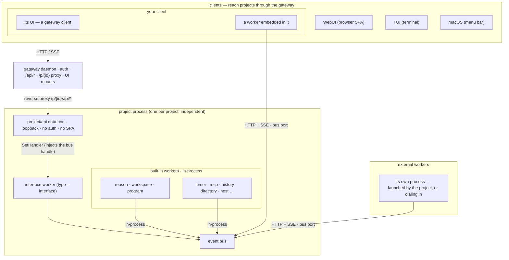
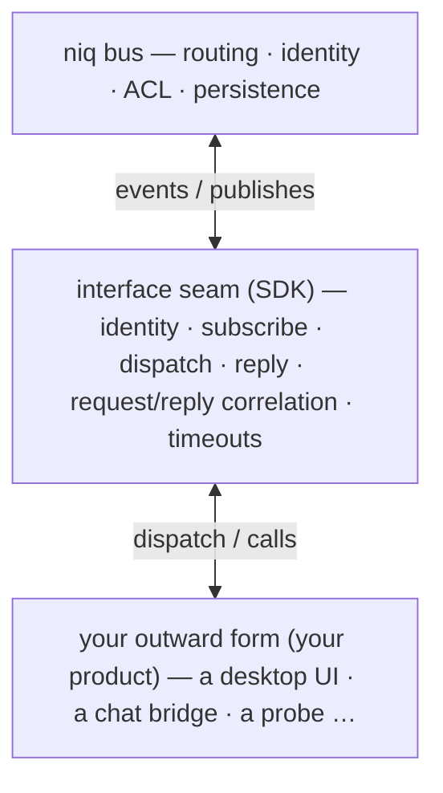
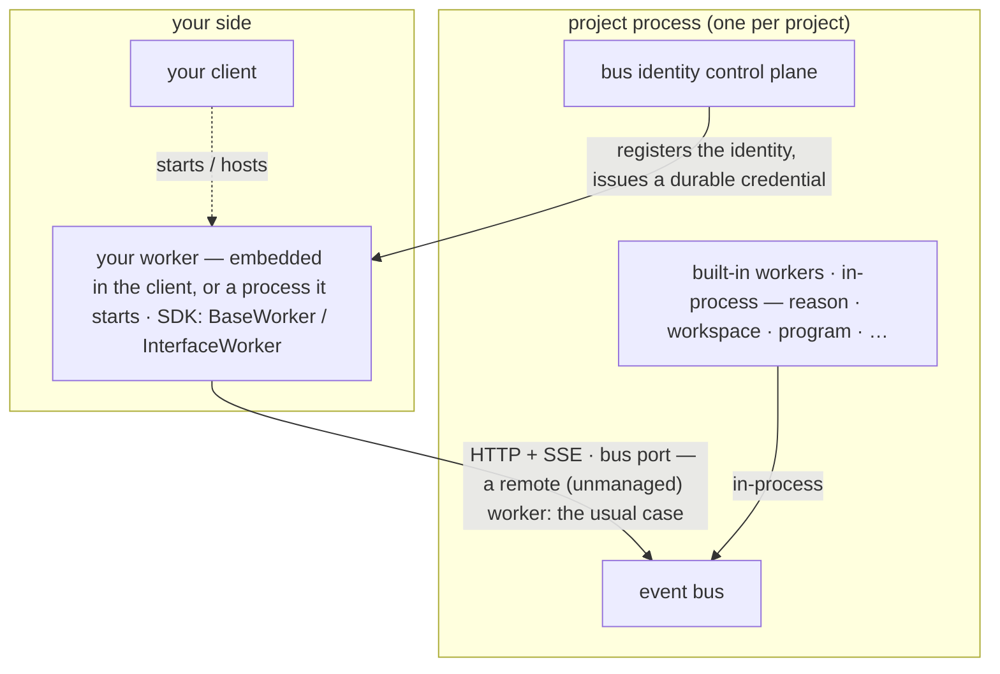
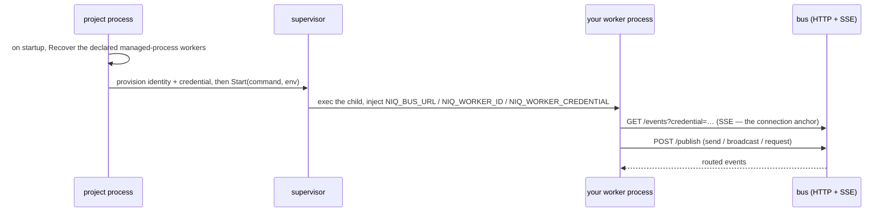
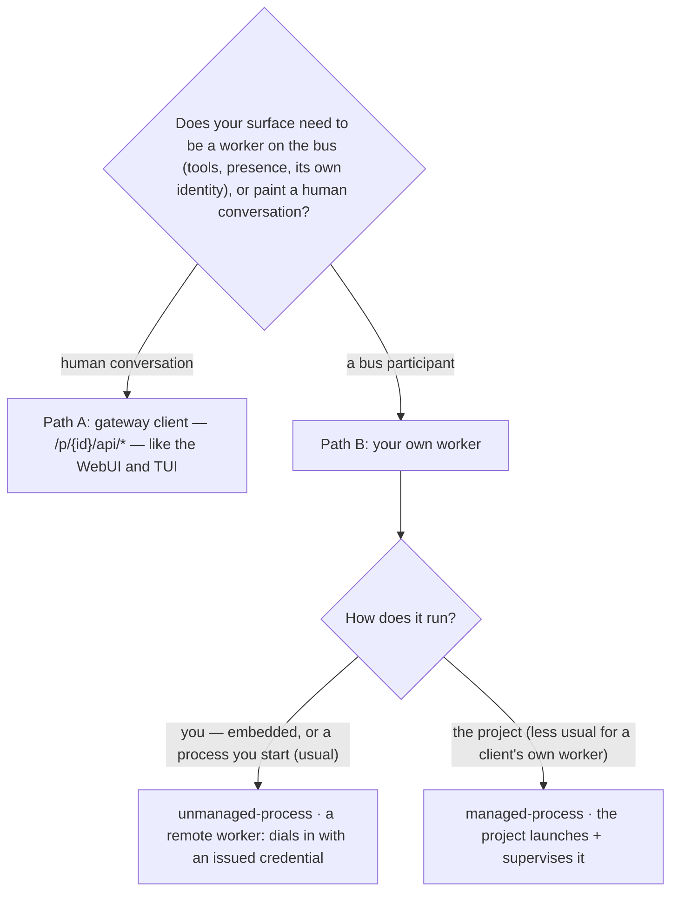

# How to build a client

> Status: as-built (2026-11-26). English · [简体中文](how-to-build-a-client.zh-CN.md).
>
> How to put a human (or a program that acts for one) in front of a running niq
> project. It explains the layering a client sits in, the concepts it speaks in,
> the two ways to connect, and the capabilities it can offer — using the WebUI
> and the terminal client as the worked examples. Where code belongs is in
> [directory-layout.md](directory-layout.md); install and CLI are in
> [install-and-cli.md](install-and-cli.md).

## 0. Overview

niq's runtime is a set of cooperating processes, each with its own role; a client attaches from the outside:

- a **gateway daemon** — the one HTTP origin every client talks to. It is the
  **entry point**: it serves the UI bundle, lists projects, manages the resources
  shared across projects (templates, the model-provider config), and proxies into
  each project. It can start / stop / restart a project as a whole, but never
  runs one itself.
- one **project process** per project — an independent process that hosts that
  project's **event bus**, its event store and its workers, and serves the
  project's own data port on loopback.
- **clients** — the WebUI, the terminal client, the macOS app, or a program you
  write. A client reaches a project only through the gateway's single origin. It
  never runs the domain in its own process, and never re-implements auth, port
  discovery or proxying — those exist once, in the gateway.

The gateway hands a client the project catalog and the shared resources. **Inside
one project** there are two planes — a functional split; both are served by the
same loopback data port, proxied by the gateway (paths below are under
`/p/<id>/api`):

| Plane (per project) | What it does | Reached at |
|---|---|---|
| **Control plane** | manage the workers that make up the project: spawn / start / stop / restart / suspend / resume / archive, edit a declaration (meta, params), and edit ACL (who may publish / subscribe) | `/workers…` — lifecycle and declaration writes are requests to the `host` worker; ACL (`/workers/<id>/allow`) writes go to the bus identity control plane |
| **Data plane** | the conversation on the project's bus: the live event stream, history, human input, approvals, the worker roster, uploads, and runtime commands to a worker (switch provider, mounts, programs, drive an event) | `/stream`, `/input`, `/events/…`, `/approvals`, `/workers/<id>/provider`, `/programs…` |

The **control plane** is about the workers themselves — which workers exist and
what they may do. The **data plane** is the traffic between them — events, and
the means to read or inject them.

For the **data plane**, an external client has two ways in — pick by what your
surface is:

1. **Use the interface worker the project already runs, over HTTP.** Every running
   project hosts an *interface worker* and exposes its data port at
   `/p/<id>/api/*` (JSON + SSE). You write no worker — you talk to that port. This
   is exactly how the **WebUI** and the **TUI** work.
2. **Bring your own worker.** When your surface must be a *participant on the
   bus* — its own identity, tools, presence, a bridge to another world — you write
   a worker and connect it to the project's bus. Most often it is a **remote
   worker**: it runs on your side — embedded in the client, or a process the client
   starts — and dials in, while the project only registers its identity and issues
   a credential. (If you would rather have the project launch and supervise it,
   that is the `managed-process` alternative.)

The rest of the document expands this: §1 the layering in detail, §2 the
concepts, §3 both ways to connect, §4 the capabilities at route level, §5 how to
choose.

## 1. Where a client sits

niq is **one binary, several process identities, a few distribution forms**.
Two invariants decide the rest:

- **A client only talks to the gateway.** It does not import the domain packages,
  does not run a project in its own process, and does not re-implement auth, port
  discovery or proxying. Those each exist exactly once, in the gateway.
- **Only the long-running processes build the runtime; a client never does.**
  The gateway daemon builds the gateway; each **project process** builds its own
  bus, event store, worker control plane and interface worker.



### The layers

| Layer | What it is | Home |
|---|---|---|
| **Distribution** | the artifact that ships a UI (CLI binary, `.app`, npm, zip) | `app/publish/` |
| **Client** | a surface a human uses; always a gateway client | `app/client/{webui,tui,mac}`, or your own |
| **Gateway** | the entry point: the one HTTP endpoint everything reaches — auth, `/api/*`, `/p/{id}` proxy, UI mounts. It lists projects, manages the shared resources, and starts/stops a project instance, but never runs one | `app/standalone/gateway` |
| **Launcher** | starts/stops/restarts a project by `exec`-ing the binary with a private verb | `app/standalone/launcher` |
| **Project process** | one project's runtime — an independent process: bus, event store, worker control plane, and its interface worker + data port | `app/standalone/project` (+ `project/api`) |
| **Core** | contracts (`core/itfs/*`) and deployment-agnostic mechanisms (`core/impl/*`) | `core/` |

Dependencies only point **`app → core`**. Forms (`standalone`, `cluster`) are
peers. A client imports `app/standalone/contract` and nothing else from the
form, so the same client package can talk to a local or a remote gateway.

### The three processes you will meet

| Process | Lifetime | Builds |
|---|---|---|
| CLI front end (`niq`, `niq i`, `niq c`) | short | almost nothing: reads paths, decides what to start, then becomes a client |
| gateway daemon | long-lived | the gateway (auth, route table, UI mounts, project list) |
| project process × N | one per project, independent | the bus, event store, worker control plane, the **interface worker**, and the `project/api` data port |

The CLI's `niq i` (picker) and `niq c <project>` (chat) are **clients**: they
resolve the gateway address, then hand off to the TUI package, which speaks HTTP
to the gateway like any other client.

### Who launches whom

For the clients that ship inside `niq`, the CLI is the entry — it starts the
**gateway**, and the "client" is then either a bundle the gateway serves or a mode
of the CLI itself:

| Built-in client | How it comes up |
|---|---|
| WebUI (browser) | bare `niq` starts the gateway daemon; the gateway serves the embedded SPA, so opening its URL *is* the WebUI |
| TUI (`niq i`, `niq c <project>`) | that CLI command runs the TUI; `ensureGatewayForUI` starts the gateway first if nothing is up |

`niq status [--json]` only reports — it does not start anything; a stopped gateway
is not an error.

A **third-party client is the reverse**: it is its own application, not launched
by the CLI, so it has to **locate and drive the `niq` binary itself** — bring the
gateway up, then talk to it over HTTP. The macOS menu bar app is the in-repo
reference for this direction:

1. **Locate `niq`** — `NIQ_BIN`, then the usual install locations, then a login
   shell's `PATH` (a GUI app inherits a minimal `PATH`).
2. **Bring the gateway up** — run bare `niq` (a control-plane start) if it is not
   already running.
3. **Act as a gateway client** — `niq status --json` for status, `/api/projects…`
   for the gateway side, `/p/{id}/api/*` for a project's data plane.

So the deciding difference is who starts whom: a built-in client is started by
`niq`; a third-party client starts `niq`. In both cases the client reaches a
project only through the gateway.

## 2. Concepts

| Concept | In one line |
|---|---|
| **Worker** | an actor on the bus: an id, its own state, changed only while handling a message. The single extension point. |
| **Event** | the only language between workers, delivered over the bus. |
| **Bus** | routes events by type; owns identity (who may publish/subscribe), channels (a live connection), and subscriptions (persistent type matches). Transport-agnostic — the same protocol runs in-process and over HTTP+SSE. |
| **Interface worker** | a worker whose job is a *seam*: one half faces the bus (identity, ACL, presence, tools), the other faces an external world via one or more **Backends**. |
| **Backend** | the outward half of an interface worker — an HTTP server, a terminal UI, a chat bridge. It receives the bus handle through `SetHandler`, once, before the worker starts. |
| **Handler** | what a backend may do on the bus as the worker's identity: `Send`, `Broadcast`, `Request`, `OnEvent`. The bus's own verbs, nothing more. |
| **Gateway** | the single origin clients reach; proxies `/p/{id}/api/*` to a project's loopback data port. |
| **project/api** | one project's **data port**: JSON + SSE on loopback, no auth, no SPA. The HTTP half. The same `*Server` is also the interface worker's **Backend** — the other half. |
| **contract** | the wire shapes (`View`, `Instance`, `Event`, `Block`, …) plus a small stdlib-only HTTP client. What a client depends on. |
| **Placement** | where a worker runs: `in-process` (built by the host), `managed-process` (an OS child the host launches and supervises), `unmanaged-process` (a worker that dials in on its own). |

### The interface worker's two halves

```
        bus ──┬── inbound: events addressed to this worker
              │        ├── request.* replies  → resolve a pending Request
              │        ├── its own tools      → extension registry (answers)
              │        └── everything else    → fan out to Backends
              └── outbound: Handler{Send, Broadcast, Request, OnEvent}
```

The worker owns the bus. Everything outward is the backend's: how to render,
how to reach a remote system, what durable state it keeps. The injection is one
call — `SetHandler` — before `Start`, so the backend can build its outward side
already knowing how to reach inward.

The WebUI is exactly this shape: `project/api`'s `*Server` is the backend; the
interface worker (`core/impl/iface`) is joined at process startup
(`joinWebUIWorker` in `project/run.go`), and `SetHandler` hands the app its bus
handle before it binds HTTP.

## 3. The two ways to connect

### Path A — use the interface worker the project already provides (over HTTP)

This is how the **WebUI** and the **TUI** work. You do not write a worker; you
talk to the project's data port.

```
client ──► gateway (auth, SPA) ──proxy /p/{id}/api/*──► project/api (loopback)
```

- **One origin.** Point at the gateway (`http://127.0.0.1:9527` by default). A
  project's data port is never addressed directly; the gateway proxies only
  `/api/*` under a project and re-resolves the port every request, so a restart
  on a new port is picked up at once.
- **The project's shell lives under `/p/<id>/`.** Use `contract.ProjectURL` (Go)
  to build it; never paste the path.
- **Reads are served by the data port itself** (its own `EventLog` and worker
  registry). **The human's writes go through the interface worker**: input,
  arbitrary events, and approval decisions all publish via the injected
  `iface.Handler`, so a human action and an agent action land on the same event
  stream. Lifecycle writes (start/stop/restart, spawn, archive) are requests to
  the `host` worker; ACL edits go straight to the bus identity control plane.

Minimal Go client:

```go
import "github.com/niq-run/niq/app/standalone/contract"

c := contract.New("http://127.0.0.1:9527")

// gateway: which projects exist, and start/stop/restart
projects, _ := c.List()

// project scoped: who is on the bus, the live event stream, sending input
stream, _ := c.Follow(ctx, "demo")          // GET /p/demo/api/stream (SSE)
defer stream.Close()
for {
    ev, err := stream.Next()
    if err != nil {
        break
    }
    _ = ev
}
_ = c.SendInput("demo", contract.Input{
    Content: []contract.Block{{Type: "text", Text: "hello"}},
    Targets: []string{"niq"},
})

// history paging, keyed off the stream's watermark
older, _ := c.EventsBefore(ctx, "demo", stream.Watermark(), contract.HistoryQuery{}, 50)
```

The same data is available with no SDK at all — it is plain JSON + SSE, so any
language can be a client:

```
GET  /p/<id>/api/workers          # identities on the bus
GET  /p/<id>/api/stream           # SSE: a watermark frame, then events; 15s heartbeats
GET  /p/<id>/api/events/before/<id>?limit=50&worker=…&type=…
POST /p/<id>/api/input            # {"content":[…],"targets":[…]}
POST /p/<id>/api/upload           # multipart file → path on the project's disk
GET  /p/<id>/api/approvals
POST /p/<id>/api/approvals/<id>/decision   # {"approved":true,"note":""}
GET  /p/<id>/api/workers/<id>/providers    # a reason worker's models
POST /p/<id>/api/workers/<id>/provider     # switch provider/model
```

**Reference implementations of Path A**

| Client | What it is | How it connects |
|---|---|---|
| **WebUI** (`app/client/webui`) | the embedded SPA | the bundle is served by the gateway; its JS calls `/p/{id}/api/*` directly |
| **TUI** (`app/client/tui`) | `niq i` picker + `niq c` conversation | an ordinary `contract.Client` over HTTP+SSE; a second process, same data port |
| **macOS** (`niq-run/clients`, `macos/`) | native SwiftUI app | reads `niq status --json`, acts via `/api/projects/{id}/{action}` |
| **Desktop shell** (`app/client/desktop`) | Tauri + `niq` sidecar | starts the CLI, then loads the gateway's own WebUI |

The TUI is the clearest template for a new out-of-tree client: it is a separate
program, imports only `app/standalone/contract`, and gets the whole conversation
(who is online, the live stream, history paging, sending input, attachments,
provider switching) over HTTP.

### Path B — bring your own worker (a third-party process)

Use this when your surface needs to be **on the bus** — to send/broadcast/request
events as its own identity, answer tools, announce presence, or act as a bridge
to another world — rather than paint a human conversation. Your process is a
worker; the project declares it, and most often the worker runs on your side and
dials in (a **remote worker**). The project can also launch and supervise it
instead (a `managed-process` worker), but that is the less common shape for a
client-owned worker.

A worker is a small actor on the bus. The bus gives you routing, request/reply
correlation, and presence; you declare what you serve and answer it. A worker
runs over HTTP+SSE with any language; the TypeScript SDK
(`@niq.run/worker-sdk`) is the convenience layer.



**Two base classes (TypeScript SDK).** Pick by who owns presence:

- `InterfaceSession` — dial, work, close. No `worker.ready`, no tools, no claim
  to be callable. A **client** of the bus. Use it for CLIs, scripts, one-shot
  tools.
- `InterfaceWorker` — connect, announce presence, serve tools, run backends. A
  **service** on the bus. Use it for a bridge, a daemon, a UI backend.

`BaseWorker` is the raw contract underneath both (identity, an extension
registry, replies, presence) — use it for a worker that has a domain of its own.

**Registering it in the project.** A worker is declared by a manifest
(`workers.json`): `id`, `type`, `params`, and a `placement`. For a worker a
client brings, the usual placement is a **remote worker** — `unmanaged-process`:

- **The usual case — a remote worker (`unmanaged-process`).** The worker runs on
  your side — embedded inside the client process, or a process the client starts —
  and **dials into the project's bus itself**. The project only **registers the
  identity and issues a durable credential**; it launches and supervises nothing.
  This is the shape when the worker belongs to the client.
- **The alternative — `managed-process`.** The **project** launches and supervises
  the worker as an OS child (a supervisor with crash-restart + backoff) and
  injects its connection env. Use it only when you want the project itself to run
  and keep alive a local process; it is not the usual shape for a client-owned
  worker.

| Placement | Who starts it | What the project provides | Typical use |
|---|---|---|---|
| `unmanaged-process` | the worker itself (the client embeds it, or starts it) | registers the identity, issues a durable credential; nothing is launched | **a client's own worker — the usual case** |
| `managed-process` | the **project**, on startup and on demand (a supervisor with crash-restart + backoff) | `NIQ_BUS_URL`, `NIQ_WORKER_ID`, `NIQ_WORKER_CREDENTIAL`, `NIQ_STATE_DIR` in the child's env | a local third-party process you want the project to run and keep alive |

`unmanaged-process` carries no `params` — the host has no channel to pass config
to a self-started worker; the worker reads its connection from the credential the
project issued (the connect block below). `managed-process` `params` are instead
the child's **environment** (a flat string map; `NIQ_*` keys are reserved and
rejected), and its credential is minted per launch and never persisted. Either
way the grants are durable, so an ACL edit survives a restart.

On project startup the project's worker control plane **recovers** the declared
set: an in-process worker replays its snapshot, and a process worker is
re-provisioned and re-launched by the supervisor — so a declared `managed-process`
worker comes up **with the project**. A remote worker is not launched by the
project; it connects whenever your side starts it.

Structurally, your worker joins the project's bus like this:



The `managed-process` alternative, as a timeline:



**Getting a credential into your worker.** For a **remote (unmanaged)** worker
the WebUI shows a *connect block* you hand to the third party:

```
NIQ_BUS_URL=http://host:port
NIQ_WORKER_ID=<id>
NIQ_WORKER_CREDENTIAL=<token>
# type=<type>
```

The SDK reads these with `readBusEnv()`; the ready-made
`@niq.run/interface-worker` reads the same block (`niq-interface config import`)
or a JSON credential file. The token is one identity's credential — keep it
private.

For the worker code itself — the base classes, the extension registry, the
connect/announce order, replying, and tests — follow the SDK's own guide:
`sdk/ts/README.md`, and the reference workers under
https://github.com/niq-run/workers (`hello` is the canonical one).

**Ready-made "bring your own client".** `@niq.run/interface-worker` is a generic
out-of-process interface worker that exposes a bus to a local process with no
SDK code — CLI one-shots (`say`, `send`, `request`, `listen`) and stdio MCP
(`mcp --persistent`). Install it, import the connect block, and an agent or
script is on the bus. The canonical *reference worker* is `@niq.run/hello-worker`
(`workers/hello`), which demonstrates state, two extensions, a declared
broadcast, `worker.readme`/`worker.help`, and fake-bus tests.

## 4. What a client can do

Three groups: what the **gateway** offers, what a project's **control plane**
offers, and what a project's **data plane** offers. The last two are served by
the same data port (`/p/<id>/api/…`).

### Gateway — entry & shared resources

| Capability | Wire |
|---|---|
| list projects with their live run state | `GET /api/projects` (`contract.Client.List`) |
| start / stop / restart a project (the instance as a whole) | `POST /api/projects/{id}/…` (`contract.Client.Start/Stop/Restart`) |
| create from a template, link a directory, browse directories, preview a template | `POST /api/projects`, `POST /api/projects/link`, `GET /api/projects/dirs`, `GET /api/projects/{id}/template-preview` |
| templates (shared): list, detail, create, zip import, update, delete | `/api/templates…` |
| model-provider config (shared): read / replace | `GET / PUT /api/providers` |

### Project control plane — manage the project's workers

| Capability | Wire (`/p/<id>/api/…`) |
|---|---|
| worker lifecycle: start / stop / restart / suspend / resume, delete, archive / restore | `/workers/<id>/…`, `DELETE /workers/<id>`, `/workers/<id>/archived` |
| worker declaration: display metadata, params, create a worker | `PUT /workers/<id>/meta`, `PUT /workers/<id>/params`, `POST /workers/create` |
| ACL: publish / subscribe grants | `PUT /workers/<id>/allow` (bus identity control plane) |

### Project data plane — the conversation on the bus

| Capability | Wire (`/p/<id>/api/…`) |
|---|---|
| worker roster (id, type, label, online), archived set | `/workers`, `/archived` |
| live event stream (watermark + events, 15s heartbeats) | `/stream` (SSE) |
| history paging (worker/role/trace/request/type filters) | `/events/before/<id>` |
| send the human's message (text / image / file blocks, @targets, input mode) | `/input` |
| abort a running request | `/abort` |
| upload an attachment (returns a path the workers can read) | `/upload` |
| approvals: list, approve / reject with a note | `/approvals`, `/approvals/<id>/decision` |
| a worker's selectable models / switch provider+model | `/workers/<id>/providers`, `/workers/<id>/provider` |
| mounts (list, add, remove) for a workspace worker | `/workers/<id>/mounts`, `/workers/<id>/mounts/…` |
| programs: list, read, edit, delete | `/programs…` |
| drive a worker with one of its declared events | `/workers/<id>/event` |
| **act as your own bus identity**: send/broadcast/request, serve tools, presence | **Path B** — connect a worker to the bus |

The split: **managing** a worker (its existence, declaration, ACL) is the control
plane; **talking to** a worker (messages, events, runtime commands, approvals) is
the data plane. A client never reaches the raw, unfiltered global event stream or
the ACL store through the interface worker — those are the app's own bus handle
and the bus identity control plane.

## 5. Choosing a path



- **A new UI / dashboard / mobile client** → Path A. Reuse the gateway, get auth,
  proxying and every domain for free.
- **A bridge to another product (chat, protocol, a desktop-native bus client)** →
  Path B with `InterfaceWorker` + a backend for the outward side.
- **A CLI, a script, a CI step, an agent** → Path B with `InterfaceSession`, or
  just use `@niq.run/interface-worker` as-is.
- **A worker with a domain of its own** (timers, search, a queue) → Path B with
  `BaseWorker`, modelled on `hello`.

## 6. Non-negotiables (and the greps that keep them)

- **A client imports only `contract` from the form.** It must not import the
  domain or `store`/`worker`.

  ```sh
  go list -deps ./app/client/... | grep 'app/standalone' | grep -v '/contract$'   # empty
  go list -f '{{join .Imports " "}}' ./app/standalone/contract | grep 'niq-run/niq'  # empty
  ```

- **The project's data port is loopback, no auth, no SPA.** The gateway owns
  auth and the bundle; the data port only emits data.
- **Auth has exactly one execution point** — the gateway. Loopback bypasses it;
  non-loopback peers are gated. Never add a second door.
- **One origin per client.** Don't address a project's data port directly; go
  through `/p/{id}/api/*`.
- **One identity = one live session.** The bus keeps a single SSE connection per
  worker id; a second connection replaces the first. Two processes need two ids.
- **The human's writes go through the interface worker.** If the handler is
  missing, writes are a loud error, never a silent no-op.

## 7. Files worth reading

| You want to … | Read |
|---|---|
| mirror the reference out-of-tree client | `app/client/tui` (esp. `chat.go`, `picker/`, `live/`) |
| see the in-tree SPA's data contract | `app/standalone/contract/talk.go`, `app/client/webui` |
| understand the interface worker | `core/impl/iface/README.md`, `iface.go` |
| see the data port and its bus half | `app/standalone/project/api/README.md`, `iface.go`, `server.go` |
| wire the WebUI worker in | `app/standalone/project/run.go` (`joinWebUIWorker`, `runAssembly`) |
| declare a third-party process | `app/standalone/worker/README.md`, `backend.go`, `process/` |
| build a worker (any language) | `sdk/ts/README.md`; reference: https://github.com/niq-run/workers (`hello`, `interface`, `lark`, `msp`) |
| the bus protocol itself | `core/itfs/bus/README.md` |
