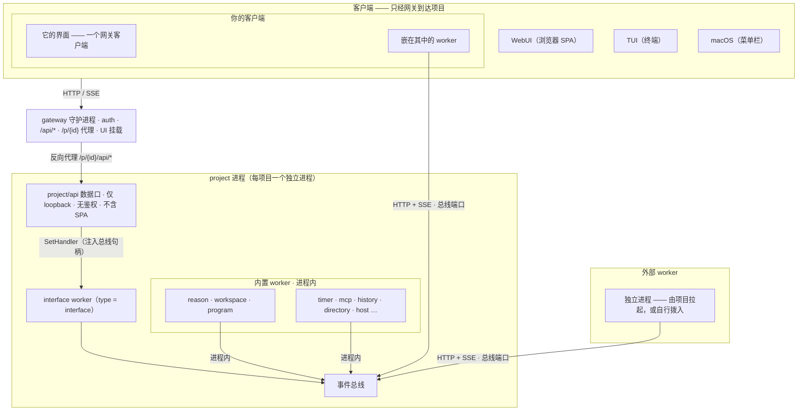
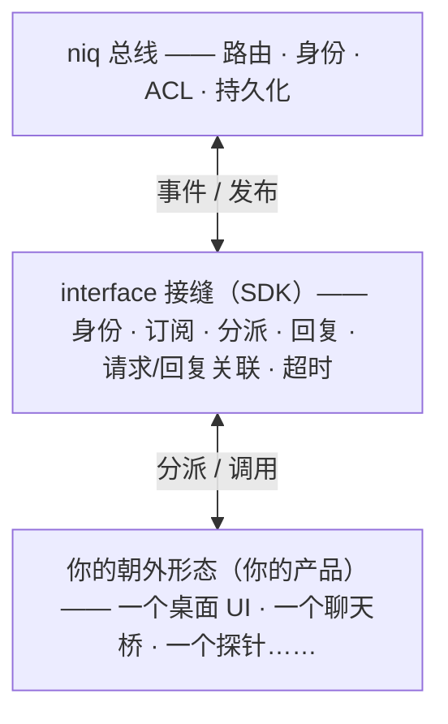
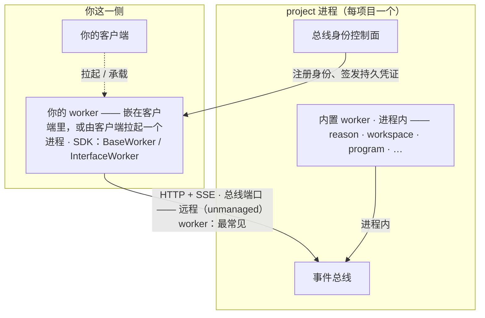
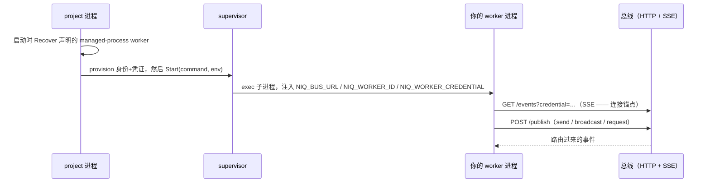
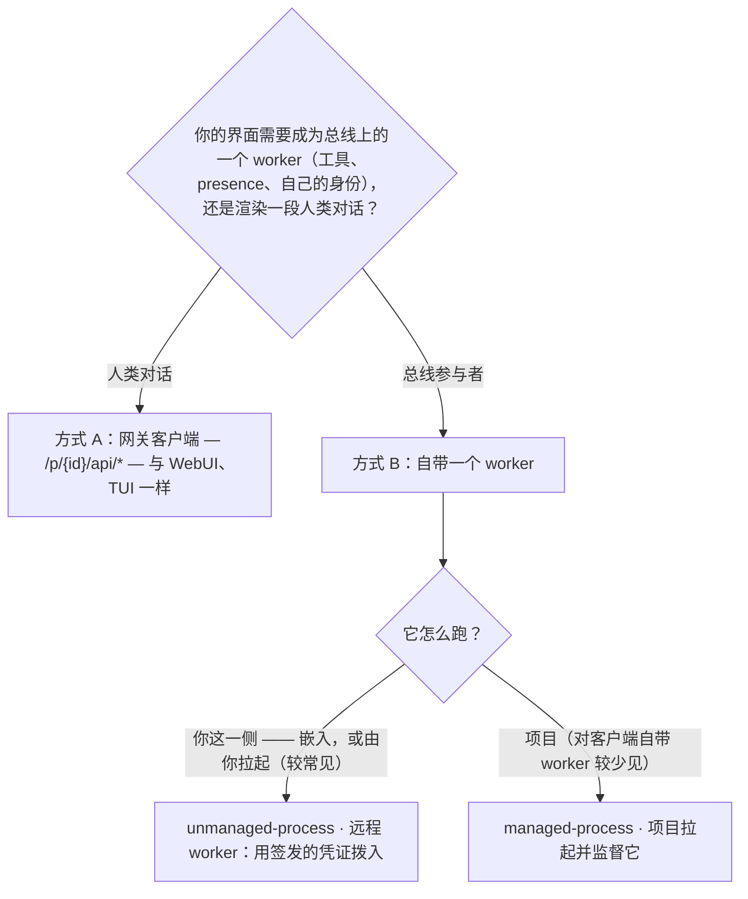

# 如何实现一个客户端

> 状态：as-built（2026-11-26）。[English](how-to-build-a-client.md) · 简体中文
>
> 讲清楚怎样把一个人（或替人操作的程序）放到一个运行中的 niq 项目前面：客户端处在哪一层、
> 用哪些概念说话、两种接入方式、以及它能提供哪些能力 —— 以 WebUI 和终端客户端作为范例。
> 代码该放哪里见 [directory-layout.zh-CN.md](directory-layout.zh-CN.md)；安装与 CLI 见
> [install-and-cli.zh-CN.md](install-and-cli.zh-CN.md)。

## 0. 概览

niq 的运行时由一组各司其职、相互协作的进程构成，客户端从外围接入：

- **gateway 守护进程** —— 所有客户端对话的唯一 HTTP origin。它是**入口**：提供 UI bundle、项目列表、
  跨项目共享资源（模板、模型 provider 配置）的管理，并把请求反向代理进每个项目。它能启/停/重启一个
  项目（作为一个整体），但从不在自己进程里运行项目。
- **每个项目一个独立的 project 进程** —— 它托管该项目的**事件总线**、事件存储与 worker，并在 loopback
  上提供项目自己的数据口。
- **客户端** —— WebUI、终端客户端、macOS 应用，或你自己写的程序。客户端只经网关这一个 origin 到达
  项目；它不在自己进程里跑领域，也不重复实现鉴权、端口发现或代理 —— 这三件事在网关里各只有一份。

网关给客户端的是项目目录与共享资源。**在一个项目内部**有两个面 —— 这是功能性切分，两者都由同一个
loopback 数据口提供、经网关代理（下列路径都在 `/p/<id>/api` 之下）：

| 面（项目内） | 做什么 | 落在哪 |
|---|---|---|
| **控制面** | 管理构成该项目的 worker：spawn / 启 / 停 / 重启 / 挂起 / 恢复 / 归档，编辑声明（meta、params），以及编辑 ACL（谁能发/谁可订） | `/workers…` —— 生命周期/声明写是对 `host` worker 的请求；ACL（`/workers/<id>/allow`）写进总线身份控制面 |
| **数据面** | 与项目总线上的对话：实时事件流、历史、人类输入、审批、worker 名单、上传，以及对某个 worker 的运行时指令（切 provider、挂载、程序、驱动事件） | `/stream`、`/input`、`/events/…`、`/approvals`、`/workers/<id>/provider`、`/programs…` |

**控制面**管的是 worker 本身 —— 有哪些 worker、各自能做什么。**数据面**是 worker 之间的往来 ——
事件，以及读写、注入它们的手段。

对**数据面**，外部客户端有两种接入形态，按你的界面是什么来选：

1. **复用项目已在内置运行的 interface worker（走 HTTP）。** 每个运行中的项目都托管一个
   *interface worker*，并把数据口暴露在 `/p/<id>/api/*`（JSON + SSE）。你不写 worker，只对那个端口
   说话。这正是 **WebUI** 与 **TUI** 的做法。
2. **自带一个 worker。** 当你的界面必须成为*总线上的参与者* —— 它自己的身份、工具、presence，或
   通往另一个世界的桥 —— 你就写一个 worker，把它接到项目总线上。**多数情况它是远程 worker**：跑在
   你这一侧 —— 嵌在客户端里，或由客户端拉起一个进程 —— 自己拨入；项目只注册身份、签发凭证。（若你想
   让项目替你拉起并监督它，那是 `managed-process` 的另一种选择。）

后文展开这些：§1 详细分层、§2 概念、§3 两种接入方式、§4 路线级能力、§5 怎么选。

## 1. 客户端处在哪一层

niq 是**一个二进制、多个进程身份、若干分发形态**。两条不变量推出其余全部结论：

- **客户端只经网关与项目交互。** 它不 import 领域包，不在自己进程里跑项目，也不重复实现鉴权、
  端口发现或代理 —— 这三件事在网关里各只有一份。
- **运行时只由长驻进程自己搭建，客户端不搭建任何东西。** 网关守护进程搭建网关；每个 **project 进程**
  搭建自己的总线、事件存储、worker 控制面，以及项目的 interface worker。



### 分层

| 层 | 是什么 | 落在哪 |
|---|---|---|
| **分发** | 随某种 UI 一起交付的产物（CLI 二进制、`.app`、npm、zip） | `app/publish/` |
| **客户端** | 人使用的界面，永远是网关的客户端 | `app/client/{webui,tui,mac}`，或你自己的 |
| **网关** | 入口：所有东西到达的唯一 HTTP 端点 —— auth、`/api/*`、`/p/{id}` 代理、UI 挂载。它列项目、管共享资源、启停项目实例，但从不亲自运行项目 | `app/standalone/gateway` |
| **launcher** | 用一个私有 verb `exec` 自己来启动/停止/重启项目 | `app/standalone/launcher` |
| **project 进程** | 单个项目的运行时（一个独立进程）：总线、事件存储、worker 控制面，以及它的 interface worker + 数据口 | `app/standalone/project`（+ `project/api`） |
| **core** | 契约（`core/itfs/*`）与不依赖部署形态的机制（`core/impl/*`） | `core/` |

依赖只允许 **`app → core`** 单向；形态（`standalone`、`cluster`）之间是同级。客户端只 import
`app/standalone/contract`，不再碰形态里的别的东西，所以同一份客户端代码可以连本地或远程网关。

### 你会遇到的三个进程

| 进程 | 生命周期 | 搭建什么 |
|---|---|---|
| CLI 前端（`niq`、`niq i`、`niq c`） | 短命 | 几乎不搭建：读路径、决定拉起谁，然后自己变成一个客户端 |
| gateway 守护 | 长驻 | 网关（auth、路由表、UI 挂载、项目列表） |
| project 进程 × N | 每项目一个（独立） | 总线、事件存储、worker 控制面、**interface worker**，以及 `project/api` 数据口 |

CLI 的 `niq i`（选择器）与 `niq c <project>`（对话）都是**客户端**：它们先解析网关地址，再交给
TUI 包，由后者像任何客户端一样对网关说 HTTP。

### 谁拉起谁

随 `niq` 一起分发的客户端，入口都是 CLI —— 由它启动**网关**，而「客户端」要么是网关提供的
bundle，要么是 CLI 自己的一个模式：

| 内置客户端 | 怎么起来 |
|---|---|
| WebUI（浏览器） | 直接运行 `niq` 会启动网关守护进程；网关提供内嵌的 SPA，打开它的地址就是 WebUI |
| TUI（`niq i`、`niq c <project>`） | 该 CLI 命令自己运行 TUI；`ensureGatewayForUI` 会在没有网关时先把网关起起来 |

`niq status [--json]` 只做汇报 —— 它不启动任何东西；网关没起来也不算错误。

**三方客户端则相反**：它是独立应用，不被 CLI 拉起，所以它得**自己去找到并驱动 `niq` 二进制** ——
把网关起来，然后走 HTTP 与之对话。macOS 菜单栏应用就是仓库里这个方向的参考：

1. **找到 `niq`** —— `NIQ_BIN`，然后常见安装位置，最后是登录 shell 的 `PATH`（GUI 应用继承的
   `PATH` 很精简）。
2. **把网关起起来** —— 若尚未运行，执行裸 `niq`（一次控制面启动）。
3. **作为网关客户端行事** —— `niq status --json` 取状态，`/api/projects…` 走网关侧，`/p/{id}/api/*`
   走某项目的数据面。

所以区别就在「谁拉起谁」：内置客户端由 `niq` 拉起；三方客户端拉起 `niq`。两种情况下，客户端都只经
网关到达项目。

## 2. 概念

| 概念 | 一句话 |
|---|---|
| **Worker** | 总线上的 actor：一个 id、自己的状态，只在处理消息时改变状态。唯一的扩展点。 |
| **Event** | worker 之间唯一的语言，经总线投递。 |
| **Bus** | 按类型路由事件；拥有身份（谁能发/订）、通道（一条活连接）、订阅（持久的类型匹配）。与传输无关 —— 同一套协议既跑进程内，也跑 HTTP+SSE。 |
| **interface worker** | 一个以「接缝」为职责的 worker：一半面向总线（身份、ACL、presence、工具），另一半经由一个或多个 **Backend** 面向外部世界。 |
| **Backend** | interface worker 朝外的另一半 —— 一个 HTTP server、一个终端 UI、一个聊天桥。它在 worker 启动前通过 `SetHandler` 一次性拿到总线句柄。 |
| **Handler** | backend 能以该 worker 身份在总线上做的事：`Send`、`Broadcast`、`Request`、`OnEvent`。就是总线自己的动词，仅此而已。 |
| **Gateway** | 客户端到达的唯一 origin；把 `/p/{id}/api/*` 反向代理到项目仅 loopback 的数据口。 |
| **project/api** | 单个项目的**数据口**：仅 loopback 的 JSON + SSE，无鉴权、不含 SPA。这是 HTTP 的那一半。同一个 `*Server` 又是 interface worker 的 **Backend** —— 另一半。 |
| **contract** | 线上形状（`View`、`Instance`、`Event`、`Block`……）加上一个只依赖标准库的小 HTTP 客户端。客户端的依赖就是它。 |
| **Placement** | worker 在哪跑：`in-process`（宿主构建）、`managed-process`（宿主拉起并监督的 OS 子进程）、`unmanaged-process`（自己拨入的 worker）。 |

### interface worker 的两半

```
        总线 ──┬── 入站：发往本 worker 的事件
               │        ├── request.* 回复   → 解析挂起的 Request
               │        ├── 它自己的工具     → 扩展注册表（作答）
               │        └── 其它一切         → 扇出给各 Backend
               └── 出站：Handler{Send, Broadcast, Request, OnEvent}
```

worker 拥有总线；朝外的一切属于 backend：怎么渲染、怎么连远端、保留哪些持久状态。注入只有一次
—— `SetHandler` —— 且在 `Start` 之前，于是 backend 可以在搭起朝外的那一侧时，就已经知道怎么向内
够到总线。

WebUI 正是这个形状：`project/api` 的 `*Server` 是 backend；interface worker（`core/impl/iface`）
由进程启动时接入（`project/run.go` 的 `joinWebUIWorker`），`SetHandler` 在 app 绑定 HTTP 之前把总线
句柄交给它。

## 3. 两种接入方式

### 方式 A —— 复用项目自带的 interface worker（走 HTTP）

**WebUI** 与 **TUI** 都是这么做的。你不用写 worker，只需对项目的数据口说话。

```
客户端 ──► 网关（auth、SPA） ──代理 /p/{id}/api/*──► project/api（loopback）
```

- **唯一 origin。** 指向网关（默认 `http://127.0.0.1:9527`）。永远不直接访问项目数据口；网关只
  代理项目下的 `/api/*`，并且每次请求都重新解析端口，所以换端口重启也能立刻跟上。
- **项目的界面挂在 `/p/<id>/` 下。** Go 里用 `contract.ProjectURL` 拼它，别手抄路径。
- **读，由数据口自己提供**（它自己的 `EventLog` 与 worker 注册表）。**人写的操作走 interface
  worker**：输入、任意事件、审批决定都经注入的 `iface.Handler` 发布，于是「人的动作」与「agent
  的动作」落在同一条事件流上。生命周期写（start/stop/restart、spawn、archive）是对 `host` worker
  的请求；ACL 编辑直接进总线身份控制面。

最小 Go 客户端：

```go
import "github.com/niq-run/niq/app/standalone/contract"

c := contract.New("http://127.0.0.1:9527")

// 网关：有哪些项目，以及启/停/重启
projects, _ := c.List()

// 项目维度：谁在总线上、实时事件流、发送输入
stream, _ := c.Follow(ctx, "demo")          // GET /p/demo/api/stream（SSE）
defer stream.Close()
for {
    ev, err := stream.Next()
    if err != nil {
        break
    }
    _ = ev
}
_ = c.SendInput("demo", contract.Input{
    Content: []contract.Block{{Type: "text", Text: "hello"}},
    Targets: []string{"niq"},
})

// 历史分页，用事件流的水位线作锚点
older, _ := c.EventsBefore(ctx, "demo", stream.Watermark(), contract.HistoryQuery{}, 50)
```

不用任何 SDK 也行 —— 它就是普通的 JSON + SSE，任何语言都能当客户端：

```
GET  /p/<id>/api/workers          # 总线上的身份
GET  /p/<id>/api/stream           # SSE：先一帧水位线，再是事件；每 15s 心跳
GET  /p/<id>/api/events/before/<id>?limit=50&worker=…&type=…
POST /p/<id>/api/input            # {"content":[…],"targets":[…]}
POST /p/<id>/api/upload           # multipart 文件 → 项目磁盘上的路径
GET  /p/<id>/api/approvals
POST /p/<id>/api/approvals/<id>/decision   # {"approved":true,"note":""}
GET  /p/<id>/api/workers/<id>/providers    # reason worker 可选模型
POST /p/<id>/api/workers/<id>/provider     # 切换 provider/model
```

**方式 A 的参考实现**

| 客户端 | 是什么 | 怎么连 |
|---|---|---|
| **WebUI**（`app/client/webui`） | 内嵌 SPA | bundle 由网关提供；它的 JS 直接调用 `/p/{id}/api/*` |
| **TUI**（`app/client/tui`） | `niq i` 选择器 + `niq c` 对话视图 | 一个普通的 `contract.Client`，走 HTTP+SSE；是独立进程、同一个数据口 |
| **macOS**（`niq-run/clients` 的 `macos/`） | 原生 SwiftUI 应用 | 读 `niq status --json`，用 `/api/projects/{id}/{action}` 操作 |
| **桌面套壳**（`app/client/desktop`） | Tauri + `niq` sidecar | 启动 CLI，然后加载网关自带的 WebUI |

TUI 是写一个新的仓外客户端最清晰的模板：它是独立程序，只 import
`app/standalone/contract`，却能拿到整套对话能力（谁在线、实时流、历史分页、发送输入、附件、
provider 切换），全靠 HTTP。

### 方式 B —— 自带一个 worker（三方进程）

当你的界面需要**本身就是总线上的参与者** —— 以它自己的身份发/广播/请求事件、回答工具、宣告
presence，或充当通往另一个世界的桥 —— 而不是渲染一段人类对话时，用这条。你的进程就是一个
worker；项目声明它，而**多数情况下 worker 跑在你这一侧、自己拨入**（远程 worker）。项目也可以改为
替你拉起并监督它（`managed-process`），但那不是客户端自带 worker 的常见形态。

worker 是总线上一个小 actor。总线给你路由、请求/回复关联、presence；你声明自己服务什么并作答。
worker 用任何语言通过 HTTP+SSE 都能跑；TypeScript SDK（`@niq.run/worker-sdk`）是便利层。



**两个基类（TypeScript SDK）。** 按「presence 归谁」来选：

- `InterfaceSession` —— 拨号、做事、关闭。没有 `worker.ready`、不注册工具、不声明可被调用。
  是总线的**客户端**。用于 CLI、脚本、一次性工具。
- `InterfaceWorker` —— 连接、宣告 presence、服务工具、跑 backend。是总线上的**服务**。用于桥、
  常驻守护、UI backend。

`BaseWorker` 是这两者之下的原始契约（身份、扩展注册表、回复、presence）—— 给你那个有自己领域的
worker 用。

**在项目里登记它。** worker 由 manifest（`workers.json`）声明：`id`、`type`、`params`，加一个
`placement`。客户端自带的 worker，**多数情况是远程 worker —— `unmanaged-process`**：

- **最常见：远程 worker（`unmanaged-process`）。** worker 跑在你这一侧 —— 嵌在客户端进程里，
  或者由客户端拉起一个进程 —— 由它**自己拨入项目总线**。项目只**注册身份、签发一个持久凭证**，
  不拉起、也不监督任何进程。worker 归客户端所有时，就是这个形态。
- **另一种：`managed-process`。** 由**项目**把 worker 作为 OS 子进程拉起并监督（带崩溃重启 +
  退避的 supervisor），并注入连接环境。只在你希望「项目自己来跑、并保活一个本地进程」时用它，
  它不是客户端自带 worker 的常态。

| Placement | 谁启动 | 项目提供什么 | 典型用途 |
|---|---|---|---|
| `unmanaged-process` | worker 自己（客户端嵌入它，或拉起它） | 注册身份、签发持久凭证；不拉起任何进程 | **客户端自带的 worker —— 最常见** |
| `managed-process` | **项目**，在启动时和按需（带崩溃重启 + 退避的 supervisor） | 子进程环境里的 `NIQ_BUS_URL`、`NIQ_WORKER_ID`、`NIQ_WORKER_CREDENTIAL`、`NIQ_STATE_DIR` | 你希望项目来跑、并保活的本地三方进程 |

`unmanaged-process` 不带 `params` —— 对自启动的 worker，宿主没有传参通道；它从项目签发的凭证里
读取连接信息（见下面的连接配置）。`managed-process` 的 `params` 则是子进程的**环境变量**（扁平字符串
表；`NIQ_*` 键是保留的，会被拒绝），凭证每次启动时签发、从不落盘。两种情况下授权（grants）都是持久的，
所以一次 ACL 编辑能撑过重启。

项目启动时，项目自己的 worker 控制面会**恢复**声明的全集：进程内 worker 回放快照，进程 worker
由 supervisor 重新 provision 并重新拉起 —— 于是一个声明好的 `managed-process` worker 是**随项目一起
起来**的。远程 worker 不由项目拉起，它在你的这一侧启动时自己连上来。

结构上，你的 worker 是这样接入项目总线的：



另一种 `managed-process`，拉起是一条时间线：



**把凭证交给你的 worker。** 对于**远程（unmanaged）** worker，WebUI 会给出一段*连接配置*交给你：

```
NIQ_BUS_URL=http://host:port
NIQ_WORKER_ID=<id>
NIQ_WORKER_CREDENTIAL=<token>
# type=<type>
```

SDK 用 `readBusEnv()` 读它们；现成的 `@niq.run/interface-worker` 读同一段（`niq-interface config
import`）或一个 JSON 凭证文件。token 是一个身份的凭证 —— 请妥善保管。

worker 自身的代码（基类、扩展注册表、连接/宣告顺序、回复、测试）不必在这里抄，直接看 SDK 自己的文档：
`sdk/ts/README.md`，以及 https://github.com/niq-run/workers 下的参考 worker（`hello` 最典型）。

**现成的「自带客户端」。** `@niq.run/interface-worker` 是一个通用、进程外的 interface worker，不写
SDK 代码就能把总线暴露给一个本地进程 —— CLI 一次性命令（`say`、`send`、`request`、`listen`）与
stdio MCP（`mcp --persistent`）。装上它、导入连接配置，一个 agent 或脚本就上了总线。最经典的
*参考 worker* 是 `@niq.run/hello-worker`（`workers/hello`），它演示了状态、两个扩展、一个声明的
广播、`worker.readme`/`worker.help`，以及基于假总线的测试。

## 4. 客户端能实现什么

分三组：**网关**提供什么、项目的**控制面**提供什么、项目的**数据面**提供什么。后两者由同一个数据口
（`/p/<id>/api/…`）提供。

### 网关 —— 入口与共享资源

| 能力 | 线 |
|---|---|
| 列出项目及其实时运行状态 | `GET /api/projects`（`contract.Client.List`） |
| 启动 / 停止 / 重启一个项目（整体实例） | `POST /api/projects/{id}/…`（`contract.Client.Start/Stop/Restart`） |
| 从模板创建、链接目录、浏览目录、预览模板 | `POST /api/projects`、`POST /api/projects/link`、`GET /api/projects/dirs`、`GET /api/projects/{id}/template-preview` |
| 模板（共享）：列、详情、创建、zip 导入、更新、删除 | `/api/templates…` |
| 模型 provider 配置（共享）：读 / 整文件替换 | `GET / PUT /api/providers` |

### 项目控制面 —— 管理项目里的 worker

| 能力 | 线（`/p/<id>/api/…`） |
|---|---|
| worker 生命周期：启 / 停 / 重启 / 挂起 / 恢复、删除、归档 / 还原 | `/workers/<id>/…`、`DELETE /workers/<id>`、`/workers/<id>/archived` |
| worker 声明：展示元数据、params、创建一个 worker | `PUT /workers/<id>/meta`、`PUT /workers/<id>/params`、`POST /workers/create` |
| ACL：发布 / 订阅授权 | `PUT /workers/<id>/allow`（总线身份控制面） |

### 项目数据面 —— 总线上的对话

| 能力 | 线（`/p/<id>/api/…`） |
|---|---|
| worker 名单（id、type、label、online），归档集合 | `/workers`、`/archived` |
| 实时事件流（水位线 + 事件，15s 心跳） | `/stream`（SSE） |
| 历史分页（按 worker/role/trace/request/type 过滤） | `/events/before/<id>` |
| 发送人的消息（文本 / 图片 / 文件块，@ 收件人，输入模式） | `/input` |
| 中断一次正在进行的请求 | `/abort` |
| 上传附件（返回 worker 能读到的路径） | `/upload` |
| 审批：列出、带备注批准/拒绝 | `/approvals`、`/approvals/<id>/decision` |
| 某个 worker 的可选模型 / 切换 provider+model | `/workers/<id>/providers`、`/workers/<id>/provider` |
| 挂载（列/加/删），针对 workspace worker | `/workers/<id>/mounts`、`/workers/<id>/mounts/…` |
| 程序：列、读、改、删 | `/programs…` |
| 用某个 worker 声明的事件去驱动它 | `/workers/<id>/event` |
| **作为你自己的总线身份**：发/广播/请求、服务工具、presence | **方式 B** —— 把一个 worker 连到总线 |

切分要点：**管理**一个 worker（它的存在、声明、ACL）是控制面；**与**一个 worker **对话**（消息、事件、
运行时指令、审批）是数据面。客户端不会经 interface worker 触达原始、未过滤的全局事件流或 ACL 存储 ——
前者是 app 自己的总线句柄，后者是总线身份控制面。

## 5. 怎么选



- **新的 UI / 看板 / 移动端** → 方式 A。复用网关，免费拿到鉴权、代理与全部领域。
- **通往另一个产品的桥（聊天、协议、原生桌面总线客户端）** → 方式 B，用 `InterfaceWorker` + 一个
  负责朝外那一侧的 backend。
- **CLI、脚本、CI、agent** → 方式 B，用 `InterfaceSession`，或直接拿
  `@niq.run/interface-worker` 来用。
- **有自己领域的 worker**（定时、搜索、队列） → 方式 B，用 `BaseWorker`，照 `hello` 写。

## 6. 不可妥协的约束（以及守住它们的 grep）

- **客户端只从形态里 import `contract`。** 它不得 import 领域包或 `store`/`worker`。

  ```sh
  go list -deps ./app/client/... | grep 'app/standalone' | grep -v '/contract$'   # 空
  go list -f '{{join .Imports " "}}' ./app/standalone/contract | grep 'niq-run/niq'  # 空
  ```

- **项目数据口仅 loopback、无鉴权、不含 SPA。** 网关负责鉴权与 bundle；数据口只出数据。
- **鉴权只有一个执行点** —— 网关。loopback 直接放行；非 loopback 才校验。永远不要开第二道门。
- **每个客户端只有一个 origin。** 别直接访问项目数据口，走 `/p/{id}/api/*`。
- **一个身份 = 一条活连接。** 总线每个 worker id 只保留一条 SSE 连接；第二条会顶掉第一条。两个
  进程就需要两个 id。
- **人写的操作走 interface worker。** 若 handler 缺失，写操作是一个响亮的错误，绝不静默吞掉。

## 7. 值得读的文件

| 你想…… | 读这个 |
|---|---|
| 照抄一个仓外客户端 | `app/client/tui`（尤其 `chat.go`、`picker/`、`live/`） |
| 看内嵌 SPA 的数据契约 | `app/standalone/contract/talk.go`、`app/client/webui` |
| 理解 interface worker | `core/impl/iface/README.md`、`iface.go` |
| 看数据口与它的总线半边 | `app/standalone/project/api/README.md`、`iface.go`、`server.go` |
| 看 WebUI worker 怎么接进来 | `app/standalone/project/run.go`（`joinWebUIWorker`、`runAssembly`） |
| 声明一个三方进程 | `app/standalone/worker/README.md`、`backend.go`、`process/` |
| 写一个 worker（任意语言） | `sdk/ts/README.md`；参考：https://github.com/niq-run/workers（`hello`、`interface`、`lark`、`msp`） |
| 总线协议本身 | `core/itfs/bus/README.md` |
